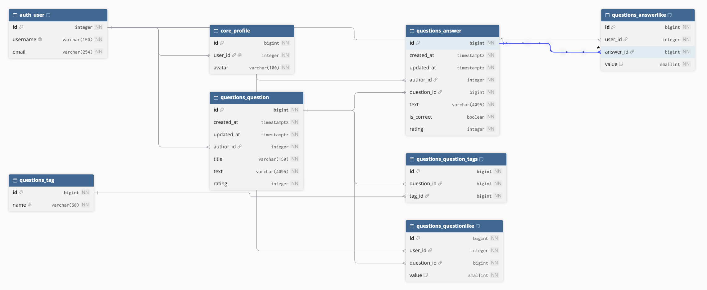

# ДЗ 3

Django + PostgreSQL. Вопросы и ответы теперь берутся из БД.

## Запуск через Docker

Создать настройки:

```bash
cp .env.example .env.docker
```

В `.env.docker` задать свои `SECRET_KEY` и `POSTGRES_PASSWORD`,
поставить `DB_HOST=db` и `DB_PORT=5432`.

```bash
docker compose up --build
```

Сайт: http://localhost:8001/ . Миграции применяются при запуске.

В другом терминале создать пользователя для админки:

```bash
docker compose exec web python manage.py createsuperuser
```

Админка: http://localhost:8001/admin/ .

Заполнить БД (сначала можно попробовать 10):

```bash
docker compose exec web python manage.py fill_db 10
```

Для объёма из ДЗ — `fill_db 10000`. Команда добавляет новые записи при каждом запуске.
На каждого пользователя создаётся 10 вопросов, 100 ответов, 200 голосов и один тег.
Вставки идут порциями по 5000.
Минимальный ratio — 2: с одним пользователем не хватает уникальных пар для 200 голосов.

Остановить: `docker compose down`. Данные сохраняются в volume PostgreSQL.

## Локальный запуск

```bash
cp .env.example .env.local
python3 -m venv .venv
source .venv/bin/activate
pip install -r requirements.txt
docker compose up -d db
cd web-edu
python manage.py migrate
python manage.py runserver
```

Для запуска БД нужен настроенный `.env.docker` из инструкции выше.
В `.env.local` указать тот же пароль БД, `DB_HOST=127.0.0.1`, `DB_PORT=55432`
и свой `SECRET_KEY`. Сайт при таком запуске: http://localhost:8000/.
Файлы `.env.local` и `.env.docker` в Git не добавляются.

## Страницы

- `/` — новые вопросы
- `/hot/` — популярные вопросы
- `/tag/<название>/` — вопросы по тегу; ссылки есть на сайте
- `/question/<id>/` — вопрос и ответы
- `/admin/` — управление данными
- `/ask/` — создание вопроса
- `/login/` — вход
- `/signup/` — регистрация
- `/profile/` — профиль

## Схема


